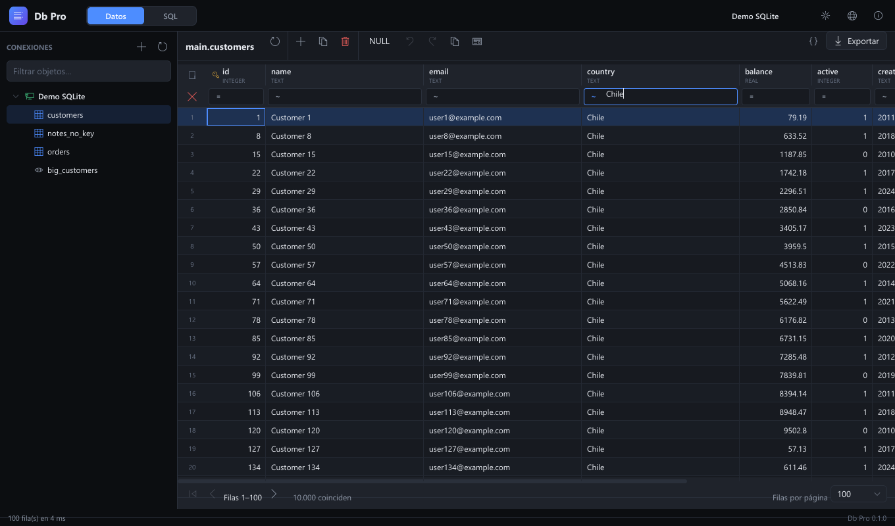
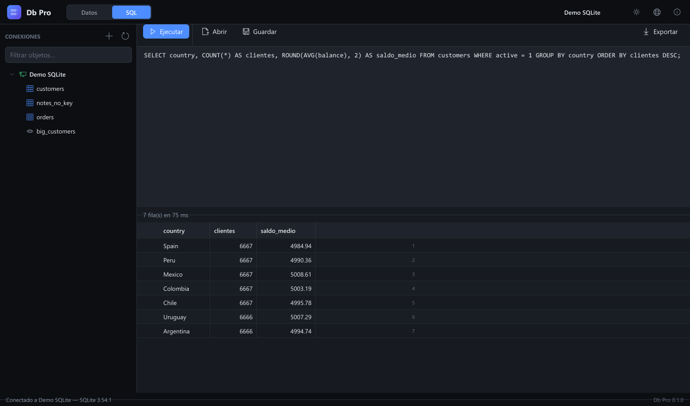
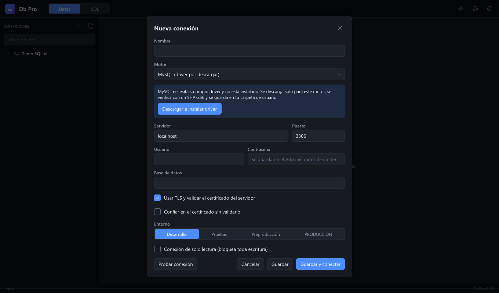

<div align="center">

# Db Pro

### Un estudio de bases de datos nativo, gratuito y para Windows.

[](#requisitos)
[](#compilar-desde-el-código)
[](https://slint.dev)
[](LICENSE)
[](#datos-y-privacidad)

**Conecta. Consulta. Explora.**

[Funciones](#funciones) · [Motores](#motores-de-bases-de-datos) · [Instalar](#instalación) · [Informar un problema](https://github.com/GonzaloCN-Dev/db-pro/issues)

</div>

Db Pro es una aplicación de escritorio en español para explorar y editar bases de datos desde una sola interfaz. Está escrita en C++ con Slint: sin Electron, sin WebView y sin servidores locales. Gratis y sin cuenta. Desarrollado por **Gonzalo Cruz Núñez**.

> **Estado: desarrollo temprano (0.2.2).** Consulta la [tabla de motores](#motores-de-bases-de-datos) y [`docs/PROGRESS.md`](docs/PROGRESS.md): solo se marcan como probados los motores con integración real.

## Capturas

| Tabla con 100 filas por página | Filtros en servidor y recuento |
| --- | --- |
|  |  |

| Editor SQL | Nueva conexión y driver opcional |
| --- | --- |
|  |  |

## Funciones

| Función | Qué puedes hacer |
| --- | --- |
| **Explorador de conexiones** | Árbol de conexiones, bases de datos, tablas y vistas, con filtro rápido de objetos. |
| **Rejilla de datos** | Ver tablas grandes sin congelar la ventana: se muestran 100 filas por página (configurable) y los datos se piden al servidor por páginas. |
| **Filtros por columna en servidor** | Cada columna tiene su propio filtro tipado (contiene, igual, mayor que, entre, es nulo…). Se aplican en la base de datos sobre **toda** la tabla, no solo sobre lo visible. Se pueden combinar. |
| **Orden remoto** | Ordenar por columna en el servidor, con paginación estable. |
| **Total bajo petición** | No se lanza ningún `COUNT(*)` automático: el total aparece como «desconocido» hasta que pulsas **Contar**. Las estimaciones se marcan con «≈». |
| **Edición con control de conflictos** | Edita celdas (comprobado en la interfaz); insertar, duplicar y borrar filas existen pero aún no se han probado en la interfaz. Antes de guardar ves el SQL exacto. Si otra persona cambió la fila, el guardado se rechaza y no se sobrescribe nada. Los cambios se aplican en bloque, o no se aplica ninguno. |
| **Seguridad al editar** | Una fila se identifica por su clave primaria. Sin clave, o en una vista, la edición está bloqueada y la aplicación te dice por qué. |
| **Exportar** | Exporta **todas** las filas que cumplen el filtro (no solo la página visible), en bloques, sin cargar el resultado entero en memoria. Formatos: CSV, TSV, JSON, NDJSON y SQL INSERT (los exportadores tienen tests automáticos; en la interfaz solo se ha comprobado CSV). |
| **Editor SQL** | Ejecuta consultas con `Ctrl+Intro` o `F5`, con límite de filas, cancelación y exportación del resultado. Botones para abrir y guardar archivos `.sql` (aún sin probar). |
| **Pestañas de tablas** | Mantén varias tablas abiertas; cada pestaña conserva sus filtros, orden, página y cambios pendientes. |
| **Rendimiento en vivo** | Actividad, bloqueos y sesiones para los motores que lo soportan. Terminar una sesión requiere confirmación; los motores no compatibles lo indican explícitamente. |
| **Ajustes y actualizaciones** | Preferencias de tema, idioma e intervalo del monitor. El comprobador de versiones es opcional; el instalador se verifica con SHA-256 antes de ejecutarse. |
| **Conexiones seguras** | Las contraseñas van al Administrador de credenciales de Windows, nunca a un archivo. Modo de solo lectura y etiqueta de entorno (Desarrollo, Pruebas, Preproducción, PRODUCCIÓN). |
| **TLS** | La validación del certificado está activada por defecto; confiar sin validar es una opción explícita. |
| **Drivers opcionales** | Solo SQLite viene dentro de la aplicación. Cada motor extra es una DLL que se descarga o instala únicamente si la eliges. |
| **Personalización** | Interfaz en español e inglés, tema oscuro y claro. |

## Motores de bases de datos

| Motor | Estado |
| --- | --- |
| **SQLite** | Incluido en la aplicación. Implementado y probado con tests y con la interfaz sobre una tabla de 70.000 filas. |
| **MySQL / MariaDB** | Driver opcional. **Probado** contra un MariaDB 10.4 real (58 comprobaciones de integración: metadatos, filtros, edición con conflicto, exportación en streaming, cancelación, solo lectura). MySQL propiamente dicho, sin probar. |
| **PostgreSQL** | Driver opcional. **Probado** contra PostgreSQL 17.5 real (59 comprobaciones de integración). |
| **SQL Server / Azure SQL** | Driver opcional (ODBC Driver 18). **Experimental:** compila y gestiona errores de conexión, pero **no se ha ejecutado contra un servidor SQL Server** (no hay ninguno en el equipo de desarrollo). |
| **MongoDB / Atlas** | Driver opcional. **Probado** contra MongoDB 8.0 real standalone (61 comprobaciones). Atlas/mongodb+srv y transacciones en réplica sin probar. |
| **Compatibles con PostgreSQL / MySQL / TDS** | YugabyteDB, EDB Postgres, Cloudberry, Greengage, Materialize, RisingWave, CrateDB, Kingbase, Fujitsu Enterprise Postgres, Yellowbrick (usan el driver PostgreSQL); TiDB y OceanBase en modo MySQL (driver MySQL); Babelfish (driver SQL Server). **Experimentales:** se conectan por el protocolo compatible, pero no se ha probado ninguno contra su servidor. |

Ningún motor se anuncia como estable hasta que sus pruebas de integración pasan contra un servidor real. La interfaz marca los motores sin driver con «(driver por descargar)» o «(aún no disponible)».

### Cómo funcionan los drivers

Al elegir un motor en **Nueva conexión**, Db Pro comprueba si su driver (`dbpro_driver_<motor>.dll`) está instalado. Si no lo está, el diálogo muestra el botón **Descargar e instalar driver**. Solo se descarga lo que eliges, por HTTPS, con el certificado validado y comprobando el SHA-256 antes de guardar el archivo. Una DLL ajena colocada en la carpeta de drivers se rechaza. Más detalles en [`docs/DRIVERS.md`](docs/DRIVERS.md).

## Instalación

1. Ejecuta el instalador **`DbPro-Setup-0.2.2.exe`**.
2. No requiere permisos de administrador para instalarse en tu usuario.
3. Durante la instalación puedes marcar los drivers opcionales que quieras incluir.
4. Inicia Db Pro desde el menú Inicio.

El instalador muestra el espacio requerido calculado por Inno Setup y reserva un margen adicional. Con todos los drivers, planifica aproximadamente **111 MiB**. Incluye el runtime de Visual C++. Es x64 para Windows 10/11 y **no está firmado**, así que Windows SmartScreen puede mostrar un aviso de editor desconocido. Al desinstalar te pregunta si quieres borrar también tus conexiones y ajustes; las contraseñas del Administrador de credenciales no se tocan.

## Requisitos

- Windows 10 u 11 de 64 bits.
- Para desarrollar: Visual Studio 2022 o posterior con C++ y CMake, Ninja, [vcpkg](https://github.com/microsoft/vcpkg) e Inno Setup 6 para el instalador.
- Conexión a Internet en la primera compilación, para descargar Slint y las dependencias.

### Versión portable

También está disponible **`DbPro-Portable-0.2.2.zip`**. Extrae la carpeta en una ubicación con permiso de escritura e inicia `DbPro-Portable.cmd`; los perfiles y ajustes se guardan en `data` junto a la aplicación. Las contraseñas siguen en el Administrador de credenciales de Windows del usuario actual: al mover la carpeta a otro usuario o equipo tendrás que volver a introducirlas.

### Tecnologías

C++20, [Slint](https://slint.dev) 1.19, [SQLite](https://sqlite.org), [nlohmann/json](https://github.com/nlohmann/json) y, en los drivers opcionales, [MariaDB Connector/C](https://github.com/mariadb-corporation/mariadb-connector-c).

## Compilar desde el código

```powershell
git clone https://github.com/microsoft/vcpkg third_party\vcpkg
third_party\vcpkg\bootstrap-vcpkg.bat
.\build.bat
build\dbpro_tests.exe
```

El ejecutable queda en `build\DbPro.exe`. Para compilar los drivers y generar el instalador:

```powershell
cmake --build build --target dbpro_drivers
powershell -ExecutionPolicy Bypass -File .\installer\build-installer.ps1
```

El instalador queda en `dist\DbPro-Setup-<versión>.exe`. Para preparar los drivers de una publicación (DLL más `drivers.json` con tamaño y SHA-256): `scripts\package-drivers.ps1`.

## Datos y privacidad

Las conexiones y los ajustes se guardan localmente en `%APPDATA%\DbPro`. Las contraseñas se guardan en el Administrador de credenciales de Windows y los perfiles exportados no las incluyen. Db Pro **no envía telemetría**, no muestra anuncios y no necesita una cuenta. Las descargas de drivers solo ocurren cuando las solicitas. Si activas el comprobador de versiones o pulsas «Buscar actualizaciones», Db Pro consulta por HTTPS las releases públicas del proyecto en GitHub; no envía información de la aplicación ni de tus bases de datos.

## Licencias

El código original de Db Pro se ofrece bajo [MIT](LICENSE). Integra componentes con sus propias licencias; consulta [`installer/LICENSES.txt`](installer/LICENSES.txt). Slint requiere mostrar su atribución: está incluida en el diálogo **Acerca de**.

## Contribuir

Las ideas, los informes de errores y las contribuciones son bienvenidos. Abre un [issue](https://github.com/GonzaloCN-Dev/db-pro/issues) para informar de un problema o proponer una mejora. Antes de abrir un PR grande, crea un issue para hablar del enfoque. Las reglas del proyecto están en [`AGENTS.md`](AGENTS.md) y [`docs/DECISIONS.md`](docs/DECISIONS.md). Para informar de una vulnerabilidad, lee [`SECURITY.md`](SECURITY.md).

## Créditos

Creado por **Gonzalo Cruz Núñez**. Interfaz construida con [Slint](https://slint.dev); JSON con [nlohmann/json](https://github.com/nlohmann/json).

---

<div align="center">
Hecho con cuidado para que trabajar con tus bases de datos sea más sencillo.
</div>

## English

**Db Pro** is a free, native Windows database studio written in C++20 with Slint. No Electron, no WebView, no telemetry.

### Status

Early development (0.2.2). SQLite is built in. PostgreSQL, MySQL/MariaDB, MongoDB and DuckDB have passed integration tests; SQL Server is compile-tested only. Check [`docs/PROGRESS.md`](docs/PROGRESS.md) for verified functionality and limitations.

### Features

- Connection tree with databases, tables and views.
- Data grid that pages from the server (100 rows by default), with typed per-column filters applied server-side across the whole table, remote sorting, and an on-demand exact count (no automatic `COUNT(*)`).
- Cell editing with a primary-key identity, the exact SQL shown before saving, optimistic concurrency (a changed row is a conflict, never silently overwritten) and all-or-nothing change sets.
- Streaming export of all filtered rows to CSV, TSV, JSON, NDJSON or SQL INSERT.
- SQL editor with cancellation and result export.
- Passwords in the Windows Credential Manager, read-only mode, environment tags, TLS validation on by default.
- Optional per-engine driver DLLs, downloaded only when you pick that engine (HTTPS, SHA-256 verified).
- Spanish and English interface; dark and light themes.

### Build

Requirements: Visual Studio C++/CMake, Ninja, vcpkg and Inno Setup 6. Run `build.bat`, then `build\dbpro_tests.exe`. Build the installer with `installer\build-installer.ps1`.

Original Db Pro code is MIT-licensed; third-party components retain their own licenses. See [`installer/LICENSES.txt`](installer/LICENSES.txt). Created by **Gonzalo Cruz Núñez**.
